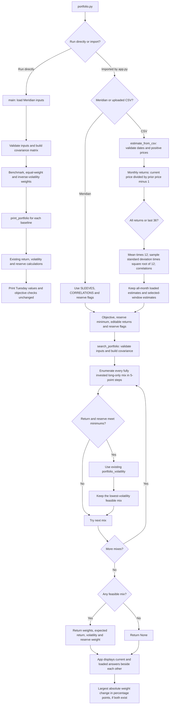

# Project 2 fund universe and price sources

Download date: **October 22, 2026** (America/Indiana/Indianapolis).

Selected tickers: **SGOV, VGIT, VCIT, ACWI**. Each covers a distinct assignment role. They differ from the practice examples BIL, IEF, LQD and VT. No money market funds are included. These replace the earlier equity-only universe; its files are retained in `archive`.

## Fund names and roles

| Ticker | Fund name | Role in this universe |
| --- | --- | --- |
| SGOV | iShares 0-3 Month Treasury Bond ETF | Cash and reserve: very short-term U.S. Treasury exposure; the assignment's Treasury-bill fund proxy for upcoming scholarship payments. |
| VGIT | Vanguard Intermediate-Term Treasury ETF | Government bonds: intermediate-term U.S. Treasury exposure, separate from the short-term payout reserve. |
| VCIT | Vanguard Intermediate-Term Corporate Bond ETF | Fixed income: diversified intermediate-term investment-grade corporate bonds. |
| ACWI | iShares MSCI ACWI ETF | Equity: broad developed- and emerging-market stock exposure, including U.S. and international large- and mid-cap companies. |

Fund identity and strategy sources: [iShares SGOV](https://www.ishares.com/us/products/314116/ishares-0-3-month-treasury-bond-etf-sgov), [Vanguard VGIT fact sheet](https://workplace.vanguard.com/assets/corp/fund_communications/pdf_publish/us-products/fact-sheet/F3143.pdf), [Vanguard VCIT](https://advisors.vanguard.com/investments/products/vcit/vanguard-intermediate-term-corporate-bond-etf.html), and [iShares ACWI](https://www.ishares.com/us/products/239600/ishares-msci-acwi-etf).

## Fit with the Cedar Grove mandate

These four funds cover all four classroom roles without duplicating the same stock-index role. They are a research universe for the learning exercise, not an optimized allocation.

Cedar Grove requires four quarterly payments in cash or direct U.S. Treasury bills with remaining maturity of one year or less. At the initial $2 million portfolio value, that is $60,000, or 3%. For this assignment, **SGOV stands in for the reserve**, following the instruction to use a Treasury-bill fund. The original mandate wording still specifies cash or direct bills, so formal fund eligibility needs clarification; no original mandate text has been silently changed. VGIT is not treated as reserve-eligible for Cedar Grove. The mandate's 40% diversified-fund cap also remains applicable to these funds; the requested Lab 14 return-and-reserve search does not enforce that separate cap.

## Historical price sources

| Ticker | Source: Yahoo Finance Historical Data, Monthly, Adj Close | Download date |
| --- | --- | --- |
| SGOV | [Monthly historical data](https://finance.yahoo.com/quote/SGOV/history/?period1=1633046400&period2=1790812800&interval=1mo) | 2026-10-22 |
| VGIT | [Monthly historical data](https://finance.yahoo.com/quote/VGIT/history/?period1=1633046400&period2=1790812800&interval=1mo) | 2026-10-22 |
| VCIT | [Monthly historical data](https://finance.yahoo.com/quote/VCIT/history/?period1=1633046400&period2=1790812800&interval=1mo) | 2026-10-22 |
| ACWI | [Monthly historical data](https://finance.yahoo.com/quote/ACWI/history/?period1=1633046400&period2=1790812800&interval=1mo) | 2026-10-22 |

The prices were retrieved programmatically from Yahoo Finance's chart endpoint, using `interval=1mo`, `period1=1633046400`, and `period2=1790812800`. The exact endpoint pattern is `https://query2.finance.yahoo.com/v8/finance/chart/TICKER?period1=1633046400&period2=1790812800&interval=1mo`. The selected field was `indicators.adjclose[0].adjclose`, not unadjusted Close. The original Yahoo JSON responses are preserved in the `source` folder.

## prices.csv conventions and checks

- Columns: `Date,SGOV,VGIT,VCIT,ACWI`, with the oldest month first.
- Coverage: **October 2021 through September 2026**, the latest 60 completed calendar months as of download. October 2026 is excluded because it is incomplete.
- Dates retain Yahoo's monthly bar labels: the **first day of the represented month**, not the date of a trade at that price. For example, `2021-10-01` labels October's monthly observation. Timestamps were interpreted in `America/New_York`.
- Prices are Yahoo's monthly adjusted-close observations in USD, accounting for the provider's distribution and split adjustments. Original numeric precision is preserved; no prices are rounded to cents, interpolated, or forward-filled.
- Validation: all four series contain the same 60 consecutive months, with no missing, duplicate, nonfinite, or nonpositive prices. The output contains 60 data rows and five columns.
- Sixty monthly prices generate **59 consecutive monthly returns** using `P[t] / P[t-1] - 1`. A subsequent requirement for 60 monthly returns would need one additional starting price from September 2021.
- Adjusted histories can be revised by the provider after later distributions or corrections. This is the snapshot downloaded on the date recorded above.

The price-data preparation did not modify the Python files. The subsequent Lab 14 extension adds `search_portfolio` and `estimate_from_csv` to `portfolio.py`, while preserving its original printed output and Meridian inputs. `app.py` imports that engine. `mandate.py` is unchanged.

## Lab 14 engine flowchart

This chart separates the unchanged command-line demonstration from the new functions called by the app. Both paths share the existing portfolio calculations.



The search checks expected return and reserve eligibility, plus full investment and long-only weights. It does not add the separate full-mandate rules such as Cedar Grove's fund cap. The minimum is over the 5-point grid. A 3% reserve floor therefore requires at least 5% in eligible assets on this grid. Sample standard deviation uses `n - 1`; the last-36 option selects 36 returns from 37 prices, while the loaded CSV comparison always uses all available returns.

## Run the Lab 14 app

## V — known-answer verification

Verified in the engine and running browser on October 22, 2026. Weights are ordered bills / 10-year / IG / equity.

| Test | Weights (%) | Expected return | Volatility |
| --- | --- | --- | --- |
| As loaded | 0 / 20 / 25 / 55 | 6.51% | 9.44% |
| Equity expected return 8% to 7% | 0 / 10 / 10 / 80 | 6.53% | 12.94% |
| IG–equity correlation 0.50 in both cells, equity return restored to 8% | 0 / 40 / 0 / 60 | 6.52% | 9.73% |

Largest weight change in the return test: **25 percentage points**, from 55% to 80% equity. A one-point reduction in one estimate reallocates a quarter of the portfolio.

The correlation test exposed stale imported inputs on browser refresh. The app now reloads `portfolio.py` and keys its cached results to the engine file's revision. Refreshing then displayed the expected 0 / 40 / 0 / 60 answer. No portfolio mathematics was copied into the app. Both correlation cells were restored to 0.25 after the test.

Browser evidence: [return sensitivity](lab14_equity7.png) and [correlation change](lab14_correlation50.png).

### Launch command

```bash
cd ~/Documents/Codex
source streamlit/.venv/bin/activate
python portfolio.py
python -m streamlit run app.py
```

The app starts with Meridian. Upload `Project2_Fund_Data/prices.csv` for SGOV, VGIT, VCIT and ACWI. SGOV starts ticked as the assignment's reserve proxy; VGIT, VCIT and ACWI start unticked. Both comparison panels use the sidebar objective and reserve minimum. For Cedar Grove's CPI + 3% target with the prior 2.5% CPI assumption, set the objective to 5.5%; the required Meridian starting value remains 6.5%.
